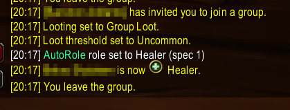
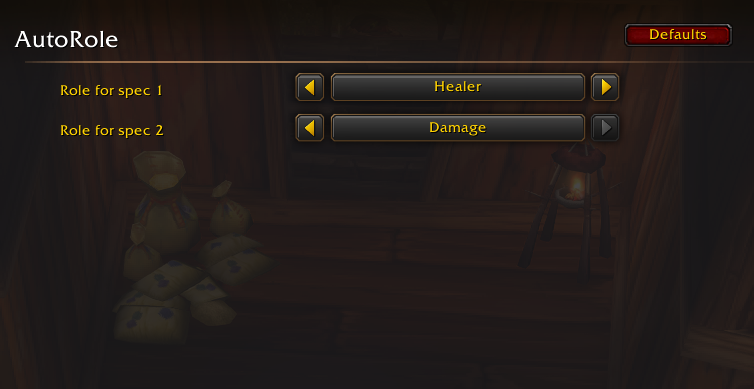

# AutoRole

Sets your group role (tank, healer, damage) automatically when you join a group or switch
spec, with or without dual spec.

## Features

- **Auto role on join** - on joining a group, your role is set to the one configured for
  the active spec.
- **Spec switch** - switching spec while in a group sets the role of the new spec.
- **Live change** - changing the role of the active spec while in a group sets it right away.
- **Without dual spec** - spec 1 is your only spec; its role applies on every join.
- **Per dual spec** - one role for spec 1 and one for spec 2; spec 2 can be set in advance
  and applies once dual spec is learned.
- **Remembered** - the roles are saved per character, since specs differ per character;
  default is "Do not change". Roles from earlier versions are kept.
- **Settings page** - all options in the game menu under Options > AddOns, also opened
  from the addon compartment menu.
- **Chat commands** - every option can also be changed by slash command.

## Screenshots





## Install

1. Download `AutoRole-vX.Y.Z.zip` from the
   [releases](https://github.com/tf4482/AutoRole/releases) (or CurseForge).
2. Unzip it into `World of Warcraft/_forever_/Interface/AddOns/`.
3. Restart the game or type `/reload`.

## Usage

```text
/autorole                     show the role per spec
/autorole spec1 <role>        set the role for spec 1
/autorole spec2 <role>        set the role for spec 2
/autorole character on        use settings for this character only
/autorole character off       use the account settings again
/autorole test                set the role of the active spec once now
/autorole reset               reset the settings to defaults
/autorole debug on            show what the addon does, until /reload
/autorole config              open the settings page
/autorole help                list all commands
```

Roles: `none` (do not change), `tank`, `healer`, `damager`. `/ar` is a short alias.

## Examples

- Protection / Holy paladin: `/autorole spec1 tank` and `/autorole spec2 healer`.
- Damage only: `/ar spec1 damager` - spec 2 stays untouched with `none`.
- Joining a group in combat: the role is set right after combat ends.
- Checking the setup in a group: `/ar test` sets the role of the active spec now.

## Develop

Check the code with [Luacheck](https://github.com/lunarmodules/luacheck) before each commit
(CI runs it on every push):

```text
luacheck .
```

Deploy locally: run `deploy.bat`; it builds `release/AutoRole-vX.Y.Z.zip` from `VERSION`.

Release: set `VERSION` to `X.Y.Z`, then push an annotated tag `vX.Y.Z`; GitHub Actions
packages the addon with the BigWigs packager and publishes it.

## License

All rights reserved, see [LICENSE](LICENSE).
